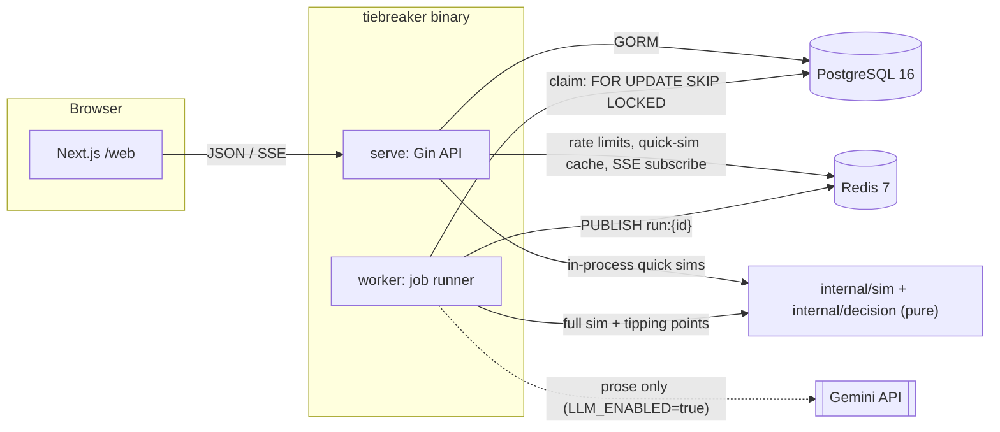
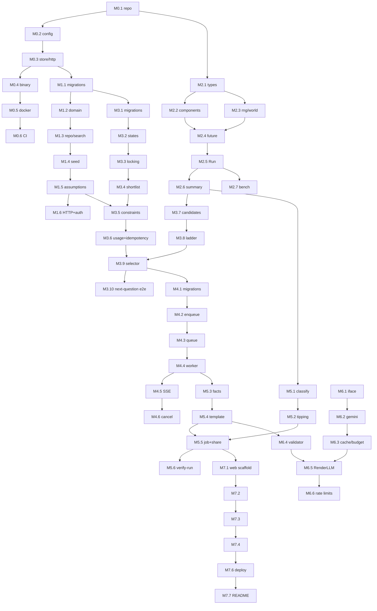

# Plan.md — Tiebreaker build plan

> This is the plan Claude Code follows to build the project in [SPEC.md](SPEC.md).
> **How to work through it:** one phase at a time. Write the tests first, tick each box as its task finishes, run the phase's test commands, update `DECISIONS.md` and `FLOW.md`, write the `docs/learning/` note, then **stop for the developer's review**. Do not start the next phase until the developer says so.
> Where this plan and SPEC.md disagree, SPEC.md wins, except for the items listed in §7 Deviations.

---

## 0. Before M0 starts (the developer's part)

| # | Prerequisite | Status on 2026-11-07 |
|---|---|---|
| P1 | Start Docker Desktop. Compose and testcontainers both need the daemon. | Client is installed, daemon not running |
| P2 | Run `gh auth login`, then choose the GitHub owner and repo name. This sets the Go module path `github.com/<owner>/tiebreaker`. | Not logged in |
| P3 | Go ≥ 1.24 | go1.26.1 installed ✅ |
| P4 | C compiler for `go test -race` on Windows (cgo) | MSYS2 gcc 14.2, `CGO_ENABLED=1` ✅ |
| P5 | Node for `/web` | v22.18.0 ✅ |
| P6 | golangci-lint v2 and golang-migrate CLI (optional, because migrations also run via `tiebreaker migrate`); k6 optional | Installed in M0.1 |
| P7 | Railway and Vercel accounts, needed only in M7. The developer runs the deploy commands; Claude prepares the configs. | — |

**Commits:** SPEC.md §18 asks for small, focused commits, so each finished task gets one commit with a descriptive message. Claude never pushes or force-pushes without asking.

---

## 1. Summary of the architecture and key decisions

### 1.1 Shape of the system

- **One binary, several subcommands:**
  - `tiebreaker serve`: the HTTP API.
  - `tiebreaker worker`: runs full simulations.
  - `tiebreaker migrate up|down`: runs golang-migrate with the plain `.sql` files, embedded in the binary.
  - `tiebreaker admin-token`: mints a short-lived admin JWT.
  - `tiebreaker verify-run --run-id`: re-runs a stored simulation and checks the result is bit-identical.
  - The seed loader is `go run ./scripts/seed`, as §7 requires.
- **Package dependencies point inward.** `internal/http` calls the services in `session`, `catalog`, `interview`, `jobs` and `report`. Those use `store` for database access. `sim` and `decision` are pure: plain structs in, plain structs out, no I/O. A golangci-lint `depguard` rule enforces that.
- **Money:** INR as `float64` inside the engine. Results are stored as `double precision`. They are rounded only when displayed, with Indian grouping (₹1,02,340).
- **Configuration:** a typed `config.Config`, built once by `config.Load(getenv)`. It takes the getenv function as a parameter, so tests can supply their own environment and nothing global is needed.

### 1.2 How the simulation works (`internal/sim`)

- **Entry point:** `Run(ctx, Inputs, Options) (Result, error)`, a pure function.
  - `Inputs` holds the cars (each with its upfront price already worked out), usage, the assumption snapshot, the preference distributions and the horizon.
  - `Options` holds `Futures`, `ChunkSize`, `Workers`, `MasterSeed`, and an optional `Progress func(doneChunks, totalChunks int)`.
- **Random numbers:**
  - Chunk `i` uses `rand.New(rand.NewPCG(masterSeed, uint64(i)))`.
  - Within a chunk, each future draws a **fixed number** of shared "world" values, in a fixed order: one fuel-price shock per energy type per year, a km variation per year, the city/highway split, one efficiency factor per fuel type, a resale market shock per fuel type, and 2 uniforms per preference attribute. Values are drawn even when they aren't used (for example, the electricity path when no EV is shortlisted). That keeps the stream aligned, so the same seed produces the same futures however the inputs change. This is "common random numbers".
  - Each future then draws a `futureSeed`. A car's own randomness (repairs, its resale shock) comes from `PCG(futureSeed, streamKey(car))`, where `streamKey` is the FNV-64a hash of the shortlist item's stable ID. Adding or removing a car therefore never changes another car's draws. The PCG source is re-seeded in place, so the hot loop allocates nothing.
- **Concurrency:** chunk jobs are handed out to `Workers` goroutines (`errgroup` with `SetLimit`; the default is `runtime.GOMAXPROCS(0)`). Each worker writes only to its own chunk's result slot, `slots[i]`. After `g.Wait()`, the slots are merged **sequentially in chunk order** into per-car sample arrays indexed by future, so the output is identical for any number of workers. `ctx.Err()` is checked every 256 futures.
- **Cost model:** follows SPEC §10 exactly, with the conventions chosen in Q8 (§1.5). `docs/model.md` documents every formula and assumption key.
- **Output:** for each car, the net-cost samples, the ownership-cost samples and the samples per cost category, all indexed by future. 50k futures × 4 cars × 10 series × 8 B is about 16 MB, which is acceptable, so no sketch is needed in v1.

### 1.3 Interview, decision and reports

- **Interview** (`internal/interview`):
  - Candidate attributes come only from real differences between the cars still in the running. Each car gets a share between 0 and 1 on the attribute's numeric scale, interpolated linearly.
  - The bracket ladder is a pure state machine: binary search over the rung indices, starting at ₹1L, at most 3 steps.
  - Adaptive selection: for each candidate, 1 quick sim with the "prior" (an equal-weight mix of the 6 brackets) plus 6 quick sims, one per bracket, all on the **same seed** derived from the session. Information gain = H(prior) − mean H(bracket). The candidates are evaluated in parallel.
  - Results are cached in Redis by inputs hash.
- **Decision** (`internal/decision`):
  - P(best) per future; if cars tie exactly, the win is split equally between them.
  - P(cheapest), percentiles (type-7 linear interpolation), winner/deadlock classification.
  - Tipping-point sweeps: 9 grid points, then bisection.
- **Reports** (`internal/report`): `BuildFacts` → `RenderTemplate` (always available) → optionally `RenderLLM` plus the fact validator. If validation fails, the template is used. `prose_source` is stored.

### 1.4 Concurrency and robustness

- **Optimistic locking:** `UPDATE sessions SET version = version+1, … WHERE id = ? AND version = ?`. If 0 rows change, the request gets `409 SESSION_VERSION_CONFLICT`. A missing `If-Match` gets `412`.
- **Idempotency:** the key row is inserted *in the same transaction* as the answer, using `ON CONFLICT DO NOTHING`, and that check happens **before** the version check. So a replay returns the stored response even after the version has moved on. If a second request arrives with the same key while the first is still running, it waits on the unique index and then reads the committed response.
- **Job queue:** claims use `SELECT … FOR UPDATE SKIP LOCKED` through GORM's `clause.Locking`. Each job has a lease with a heartbeat. Writes are fenced: completion runs `UPDATE … WHERE id = ? AND worker_id = ? AND status = 'running'`, so a worker whose lease expired can never write its result. There is also a unique `(run_id, shortlist_item_id)` on results. Jobs that fail are retried up to 3 times, then marked `failed`.
- **Progress:** published on Redis `run:{id}` and stored in `sim_runs.progress`. The SSE handler **subscribes first, then reads the database row**, so it can't miss an update between the two.
- **Cancel:** sets `cancel_requested`. The worker's heartbeat polls the flag every second and cancels the job's context.

### 1.5 Your answers from Step 1 (all "recommended")

| # | Question | Decision |
|---|---|---|
| 1 | Used cars | **In M3.** The engine supports them from M2. Resale = asking price × curve(current age + T) / curve(current age) × shocks. |
| 2 | Frontend | **Claude builds it in M7** (three thin screens plus the public share page). |
| 3 | States | **TN, KA, MH, DL.** |
| 4 | Gemini P2 uses | **Outside M0–M7.** `GenerateJSON` and `llm.Fake` are built and tested in M6. Free-text usage parsing and brochure import become an optional M8 after review. |
| 5 | Assumption values | **PLACEHOLDER values** for all keys in the 4 states, marked `verified=false` and `source_url="TODO"`. The API and UI show a "placeholder assumptions" banner. The developer replaces them with sourced values. |
| 6 | Unasked preferences | The **final simulation counts them as ₹0**, and the report lists them as "not asked". For information gain, the attribute being evaluated uses an equal-weight 6-bracket mix as its "before" state, so the gain is never negative. The stop rule uses the current state (answered brackets; unasked = 0), which is the same state the final simulation uses. |
| 7 | Safety scale | **Stars only.** The question is asked only when every remaining car has a rating, with a warning if the rating bodies differ. Airbags and ESC differences come up through `features` (`6_airbags`, `esc`). An unrated car is never treated as 0. |
| 8a | Discount rate | Treated as a **nominal** opportunity-cost rate. The env name `DISCOUNT_RATE` stays at 0.07. |
| 8b | Answer shapes | **Ranges** for km/month and the city/highway split. **Single values** for ownership years and the loan terms (amount, annual rate, tenure in months), or cash. |
| 8c | On-road price | The computed on-road price **excludes first-year insurance**; insurance is counted every year from year 1. The override field is labelled "on-road price excluding insurance". |
| 8d | One car survives | Skip the trade-off interview, but still run usage questions and the full simulation. Winner report: "the only car that meets your constraints". |

### 1.6 Other decisions taken during planning (also logged in `DECISIONS.md` in M0)

- **Ladder vs. information gain:** pick the attribute by information gain over the 6 final brackets, then finish its ladder (at most 3 steps). Stop rules are checked between steps. A ladder cut short leaves a wider bracket (e.g. "yes at ₹1L" → `[1L, 8L]`).
- **Ladder mechanics:** rungs `[0, 25k, 50k, 1L, 2L, 4L]`, cap `8L`. State is `(lo, hi)` rung indices, starting at `(0, 6)`. Ask rung `m = (lo+hi)/2`: "yes" sets `lo = m`, "no" sets `hi = m`; stop when `hi − lo = 1`. That asks ₹1L first, takes at most 3 steps, and never asks about ₹0.
- **Session states:**
  - `PUT /constraints` is allowed only in SHORTLISTING. It moves the session to USAGE, or to DONE with a `none_fit` report if every car is eliminated.
  - The last usage answer moves it to INTERVIEW.
  - `POST /simulations` moves INTERVIEW to SIMULATING.
  - When the job finishes, SIMULATING → DONE. A cancelled or failed run sends it back from SIMULATING to INTERVIEW.
  - Adding or removing cars is allowed only in SHORTLISTING. Anything else returns `409 ILLEGAL_STATE_TRANSITION`.
- **Sample catalogue data is fictional** ("Sample Motors Alpha/Beta/Gamma"). There are 3 variants, all `verified=false`, with source URLs `https://example.invalid/placeholder`. That way no real car is described with made-up numbers (§7).
- **What counts as automatic:** `automatic` = any transmission other than `manual`. **Features:** only keys in the vocabulary file `data/seed/features.json` count as meaningful; at most 2 feature questions. **Warranty scale:** years, or km if the years are equal.
- **City/highway split:** blends the city and highway real-efficiency factors (`real_efficiency_factor.<fuel>.city|highway`). Parking type is stored but not used in v1.
- **Warranty also lowers repair cost:** repairs inside the warranty period are reduced by the share in `repairs.warranty_coverage`. The warranty question asks only about the value *beyond* that saving.
- **Loan outstanding at the end of the horizon** is paid at T, discounted by `discount(T)`. Loan amount per car = min(loan, upfront price).
- **Tipping points** are computed in the worker as part of the full-run job, not in the API.
- **Gemini API surface:** `client.Models.GenerateContent` with `GenerateContentConfig`. The newer Interactions API also exists, but the spec's `ClientConfig` usage and our interface map directly onto `GenerateContent`, which is the stable, long-standing surface.
- **Integration tests** carry the build tag `integration` and run with `go test -race -tags=integration ./...`. Plain `go test -race ./...` runs the unit tests without Docker.

### 1.7 Gemini facts checked on 2026-11-07 (official sources, not memory)

Checked against [pkg.go.dev/google.golang.org/genai](https://pkg.go.dev/google.golang.org/genai), the module source of **v1.76.0**, and [aistudio.google.com/docs/models](https://aistudio.google.com/docs/models) (the old `ai.google.dev/gemini-api/docs/models` URL now redirects there).

- **Module version:** pin `google.golang.org/genai v1.76.0`, published 2026-10-22. The latest, v1.77.0 (2026-10-29), is less than 2 weeks old. The module's `go.mod` declares `go 1.24`. The README advises pinning to `< 2.0.0`.
- `func NewClient(ctx context.Context, cc *ClientConfig) (*Client, error)`.
  - `ClientConfig` fields used: `APIKey`, `Backend`, `HTTPOptions`.
  - The backends are `BackendGeminiAPI`, `BackendVertexAI` and `BackendEnterprise`.
- `func (m Models) GenerateContent(ctx context.Context, model string, contents []*Content, config *GenerateContentConfig) (*GenerateContentResponse, error)`. It is called as `client.Models.GenerateContent(...)`, and `resp.Text() string` returns the text.
- **`GenerateContentConfig` fields used:**
  - `SystemInstruction *Content` (via `genai.NewContentFromText(text, role)`)
  - `MaxOutputTokens int32`
  - `Temperature *float32` (via `genai.Ptr[float32](…)`)
  - `ResponseMIMEType string` (`"application/json"`)
  - `ResponseJsonSchema any` (when it is set, `ResponseSchema` must be left out)
  - `ThinkingConfig *ThinkingConfig{ThinkingLevel: genai.ThinkingLevelMinimal}`
  - `HTTPOptions *HTTPOptions`
- **`HTTPOptions`:** `BaseURL` (lets tests point the real adapter at an `httptest` server), `Timeout *time.Duration`, `RetryOptions *HTTPRetryOptions`.
  - `HTTPRetryOptions` has `Attempts *int32` (counts the original request; default 5) and `HTTPStatusCodes []int32`, among others.
  - We set `Attempts=2` (= at most 1 retry) on `429, 500, 502, 503, 504`.
- **Errors:** `genai.APIError{Code int; Message string; Status string; Details …}` is returned **as a value**, so the check is `var apiErr genai.APIError; errors.As(err, &apiErr)`.
- **Finish reason:** `FinishReasonMaxTokens` counts as a failure and triggers the template fallback.
- **Environment variables:** the SDK reads `GOOGLE_API_KEY` and `GEMINI_API_KEY` and, when both are set, logs a warning and **uses `GOOGLE_API_KEY`** (confirmed in `client.go`). `config.Load` therefore **fails fast** if `LLM_ENABLED=true` and `GOOGLE_API_KEY` is set.
- **Model:** `GEMINI_MODEL=gemini-3.5-flash-lite` goes in `.env.example`. It is labelled **Stable** and described as the "fastest, most cost-effective 3.5 model"; its default thinking level is `minimal`. The code has no default model.
  - The docs show models changing quickly: `gemini-2.5-flash` is deprecated and gets re-routed on 2026-12-01. That is why the model must stay an env var.
  - The alias `gemini-flash-latest` exists (2-week notice before it changes), but a pinned stable ID is preferred for reproducible prose.
- **Re-check at the start of M6:** if a newer genai version is more than 2 weeks old by then, move to it after reading its changelog. Confirm the model is still Stable.

---

## 2. Phases (M0–M7)

Each task should take about 2–4 hours. Every task lists the files it creates or changes, the tests to write **first** (`TestName` — what it asserts), and the command that proves it works. Unit-test commands use `-race`. Integration commands use `-tags=integration` and need Docker.

### M0 — Skeleton

**Goal:** a runnable, lintable, containerised skeleton with health checks and CI.

**Acceptance (SPEC §20):** `docker compose up` runs api + worker + postgres + redis; `/healthz` and `/readyz` work; CI is green.

- [x] **M0.1 Repo, module, tooling**
  - Files: `go.mod` (module `github.com/<owner>/tiebreaker`, `go 1.26`), `.gitignore`, `.editorconfig`, `.golangci.yml` (v2 format: `govet`, `staticcheck`, `errcheck`, `revive`, `gosec`, `depguard` banning `internal/{http,store,llm,jobs}`, GORM and Redis from `internal/sim` and `internal/decision`), `DECISIONS.md`, `FLOW.md`, `README.md` (stub), `docs/architecture.md` (stub).
  - Dependencies: pin each to its newest release that is at least 2 weeks old, checked on `proxy.golang.org`. That covers gin, gorm, gorm.io/driver/postgres, golang-migrate/v4, go-redis/v9, testcontainers-go, goleak, x/sync, golang-jwt/v5, genai v1.76.0.
  - Tests: none (tooling only).
  - Proof: `go build ./... && golangci-lint run ./...`
- [x] **M0.2 Typed config**
  - Files: `internal/config/config.go`, `internal/config/config_test.go`.
  - Tests:
    - `TestLoad_AppliesSpecDefaults`: every default in §17 (50000, 2000, 1000, 0, 10, 0.65, 0.02, 0.55, 0.15, 0.07, 60).
    - `TestLoad_MissingRequiredListsAllMissing`: `DATABASE_URL`, `REDIS_URL` and `JWT_SECRET` all appear in one error.
    - `TestLoad_LLMEnabledRequiresKeyAndModel`.
    - `TestLoad_LLMEnabledRejectsGoogleAPIKey`.
    - `TestLoad_LLMDisabledIgnoresMissingKey`.
    - `TestLoad_InvalidValues` (table: non-numeric, negative futures, a probability > 1, an unsorted ladder).
    - `TestConfig_LogValueRedactsSecrets`: the `slog` output contains neither the key nor the JWT secret.
  - Proof: `go test -race ./internal/config/...`
- [x] **M0.3 Store connections, transaction helper, errors, health endpoints**
  - Files: `internal/store/postgres.go` (`Open` with pool limits and ping timeout), `internal/store/tx.go` (`WithTx(ctx, db, fn)`), `internal/store/redis.go`, `internal/http/router.go`, `internal/http/health.go`, `internal/http/errors.go` (one error shape plus one domain-error → status table), `internal/http/middleware.go` (request ID, `slog` access log, body-size limit, recovery), `internal/apperr/errors.go` (sentinel and typed domain errors, so `http` and the services share them).
  - Tests:
    - `TestHealthz_Returns200`.
    - `TestReadyz_Returns503WhenDatabaseDown` and `TestReadyz_Returns503WhenRedisDown` (fake `Pinger`s).
    - `TestReadyz_Returns200WhenAllUp`.
    - `TestErrorResponse_HasCodeMessageDetails`.
    - `TestMapError_DomainErrorsToStatus` (table: not found → 404, version conflict → 409, illegal transition → 409, missing If-Match → 412, idempotency mismatch → 422, rate limited → 429, dependency down → 503, validation → 400).
    - `TestBodyLimit_Returns413`.
  - Proof: `go test -race ./internal/http/... ./internal/store/...`
- [x] **M0.4 Binary with subcommands and graceful shutdown** *(done: shutdown logic lives in `serve.go`; no separate `shutdown.go` was needed)*
  - Files: `cmd/tiebreaker/main.go` (subcommand dispatch; the only place allowed to `os.Exit`), `cmd/tiebreaker/serve.go`, `cmd/tiebreaker/worker.go` (an idle loop for now), `cmd/tiebreaker/shutdown.go`.
  - `http.Server` gets `ReadHeaderTimeout`, `ReadTimeout`, `WriteTimeout` (0 on SSE routes, which use a per-handler deadline instead) and `IdleTimeout`. Signals are handled with `signal.NotifyContext`.
  - Tests:
    - `TestServe_ShutsDownWhenContextCancelled`: the server starts on `:0`, the context is cancelled, and the call returns `nil` within 5 s.
    - `TestUnknownSubcommand_ReturnsUsageError`.
  - Proof: `go test -race ./cmd/...`, then `go run ./cmd/tiebreaker serve` and `curl -i localhost:8080/healthz`.
- [x] **M0.5 Docker and Compose** *(done: the one-shot `migrate` service is added in M1.1, when the first migration exists)*
  - Files: `Dockerfile` (multi-stage, `golang:1.26` builder, distroless static non-root runtime, `CGO_ENABLED=0`), `docker-compose.yml` (postgres:16 and redis:7 with healthchecks, then `migrate` (one-shot), `api`, `worker` using `depends_on: condition: service_healthy`), `.env.example` (every §17 key plus the extras in §7 D10, `LLM_ENABLED=false`, `GEMINI_MODEL=gemini-3.5-flash-lite`, and a comment warning not to set `GOOGLE_API_KEY`), `.dockerignore`.
  - Tests: none.
  - Proof: `docker compose up -d --build && curl -fsS localhost:8080/healthz && curl -fsS localhost:8080/readyz && docker compose ps`. Then `docker compose stop redis` and check that `curl -i localhost:8080/readyz` returns 503.
- [x] **M0.6 Integration-test harness and CI** *(CI green: run 42390778783, 2026-11-07)*
  - Files: `internal/testutil/containers.go` (start Postgres 16 and Redis 7 through testcontainers; one container per package, reused via `TestMain`), `internal/store/store_integration_test.go`, `.github/workflows/ci.yml` (jobs: `lint` (golangci-lint-action), `unit` (`go test ./...`), `race` (`go test -race ./...`), `integration` (`go test -race -tags=integration ./...` on ubuntu-latest), and later `web`).
  - Tests: `TestOpen_PingsRealPostgres`, `TestWithTx_RollsBackOnError`, `TestWithTx_CommitsOnNil`, `TestRedis_PingsRealRedis`.
  - Proof: `go test -race -tags=integration ./internal/store/...`, then push and `gh run watch`.
- [x] **M0.7 Phase docs**
  - `DECISIONS.md`: the stack, single binary, config without globals, `apperr` package, build tag for integration tests, every §1.5/§1.6 decision.
  - `FLOW.md`: startup → `config.Load` → `store.Open` → router → request flow for `/readyz` → shutdown.
  - Learning note: **`docs/learning/00-skeleton-config-shutdown.md`**. Covers modules, `main` vs `internal`, `context.Context`, `signal.NotifyContext`, `http.Server` timeouts, `log/slog`, Gin middleware, readiness vs liveness, Docker multi-stage builds. Ends with 3 interview questions.

### M1 — Catalogue

**Goal:** a database schema for car data and assumptions, a seed loader, search, and visible "unverified" flags.

**Acceptance (SPEC §20):** migrations, seed loader, variant search; unverified-data flag shown.

- [x] **M1.1 Migration runner + migrations 0001–0003**
  - Files: `migrations/embed.go` (`//go:embed *.sql`), `migrations/0001_create_variants.{up,down}.sql`, `0002_create_variant_sources.*`, `0003_create_assumptions.*`, `internal/store/migrate.go` (golang-migrate with an `iofs` source), and the `migrate` subcommand in `cmd/tiebreaker`.
  - Tests (integration):
    - `TestMigrations_UpDownUpIsClean`.
    - `TestVariants_CheckConstraintsRejectInvalidRows` (table: unknown `fuel_type`, an EV with no `battery_kwh`, 6 stars, `discontinued_year < launch_year`, 0 seats, a negative price).
    - `TestAssumptions_UniqueKeyPerModelVersion`.
  - Proof: `go test -race -tags=integration ./internal/store/...` and `docker compose run --rm migrate`.
- [x] **M1.2 Catalogue domain and validation**
  - Files: `internal/catalog/variant.go` (`Variant`, `FuelType`, `Transmission` enums, `Validate()`), `internal/catalog/source.go`, `internal/catalog/verify.go` (`CanVerify`: every non-null field has at least one source), `internal/catalog/derived.go` (PS per tonne; EV km/kWh = claimed range ÷ battery when no efficiency is given).
  - Tests:
    - `TestVariantValidate_Table`.
    - `TestCanVerify_FailsWhenAnyNonNullFieldUnsourced`.
    - `TestCanVerify_IgnoresNullOptionalFields`.
    - `TestPowerToWeight_PSPerTonne`.
    - `TestEVEfficiency_DerivedFromRangeAndBattery`.
    - `TestIsAutomatic_EverythingExceptManual`.
  - Proof: `go test -race ./internal/catalog/...`
- [x] **M1.3 Catalogue repository and search** *(done: repository and service are combined in `service.go`)*
  - Files: `internal/catalog/repo.go` (GORM; `text[]` mapping for `key_features`), `internal/catalog/service.go` (`Search(ctx, q, fuel, limit)` using trigram `ILIKE` on make+model+variant; `limit` defaults to 20 and is capped at 50; `Get(ctx, id)` includes sources).
  - Tests (integration):
    - `TestSearch_MatchesMakeModelVariantCaseInsensitive`.
    - `TestSearch_FiltersByFuel`.
    - `TestSearch_ClampsLimit`.
    - `TestGet_IncludesSourcesAndVerifiedFlag`.
    - `TestGet_UnknownIDReturnsNotFound`.
  - Proof: `go test -race -tags=integration ./internal/catalog/...`
- [x] **M1.4 Seed files and loader** *(done: the feature vocabulary is `catalog.KnownFeatures()` in Go instead of `features.json`, see D-M1-7)*
  - Files:
    - `data/seed/sample-motors-alpha.json`, `sample-motors-beta-ev.json`, `sample-motors-gamma.json` (fictional, `"verified": false`, placeholder sources). They are built to differ on several interview attributes.
    - `data/seed/features.json` (feature vocabulary with labels).
    - `data/seed/assumptions/common.json` plus `TN.json`, `KA.json`, `MH.json`, `DL.json` (every key in `docs/model.md`; values marked `PLACEHOLDER`, `verified: false`, `source_url: "TODO"`).
    - `internal/catalog/seed.go` (`LoadDir(ctx, dir)`: strict JSON decode with `DisallowUnknownFields`, validate, upsert by `slug` in one `WithTx`).
    - `scripts/seed/main.go`.
  - Tests:
    - `TestLoadSeed_RejectsUnknownFields`.
    - `TestLoadSeed_RejectsVerifiedWithoutSources`.
    - `TestSeedRepo_AtMostThreeVariantsAllUnverified`: a guard test over the real `data/seed`. It fails if a variant is marked verified while its sources are still placeholders (§7).
    - `TestAssumptionSeed_EveryKeyPresentForEveryState`.
    - `TestLoadSeed_IdempotentUpsert` (integration: load twice → still 3 rows, sources not duplicated).
  - Proof: `go test -race ./internal/catalog/... && go run ./scripts/seed --dir data/seed`
- [x] **M1.5 Typed assumption set**
  - Files: `internal/catalog/assumptions.go` (`LoadSet(ctx, state, modelVersion) (AssumptionSet, error)`; typed fields for every key; `Snapshot() json.RawMessage`; `Warnings()` lists placeholder or unverified keys), `internal/catalog/roadtax.go` (slab rule evaluation).
  - Tests:
    - `TestAssumptionSet_ParsesEveryKey`.
    - `TestAssumptionSet_MissingKeyIsError`.
    - `TestAssumptionSet_WarnsOnUnverified`.
    - `TestRoadTax_SlabByFuelAndPrice` (table with fictional slab numbers that exist only in the test).
    - `TestSnapshot_RoundTripsExactly`.
  - Proof: `go test -race ./internal/catalog/...`
- [x] **M1.6 Catalogue HTTP and admin auth**
  - Files: `internal/http/variants.go`, `internal/http/dto_variant.go` (`verified`, `warnings: ["unverified_data"]`, sources with `checked_at`), `internal/http/auth.go` (HS256 JWT, `role=admin`, `exp` ≤ 15 min, `iss`/`aud` checked), `internal/http/admin_variants.go` (POST, PUT, DELETE), and the `admin-token` subcommand.
  - Tests:
    - `TestVariantsSearch_400OnBadLimit`.
    - `TestVariantsSearch_ReturnsUnverifiedWarning`.
    - `TestVariantGet_404`.
    - `TestAdminAuth_RejectsMissingExpiredWrongRoleWrongSig` (table).
    - `TestAdminCreate_ValidatesBody`.
    - `TestAdminSetVerified_RejectedWithoutSources`.
  - Proof: `go test -race ./internal/http/...`, then `curl "localhost:8080/v1/variants?q=alpha&limit=5"` and `curl localhost:8080/v1/variants/<id>`.
- [x] **M1.7 Phase docs**
  - `docs/model.md`: a table of every assumption key, with unit, meaning, `PLACEHOLDER` status and `TODO` source.
  - Update `DECISIONS.md` and `FLOW.md`.
  - Learning note: **`docs/learning/01-catalogue-migrations-gorm.md`**. Covers golang-migrate vs AutoMigrate, `embed`, GORM models and `text[]`, `CHECK` constraints, trigram indexes, `json.Decoder.DisallowUnknownFields`, JWT validation. Ends with 3 questions.

### M2 — Simulation engine

**Goal:** a pure, deterministic, concurrent, cancellable Monte Carlo engine.

**Acceptance (SPEC §20):** §10.1 met; hand-checkable, common-sense, determinism and cancellation tests pass; benchmark recorded.

- [x] **M2.1 Engine types and validation**
  - Files: `internal/sim/types.go` (`Inputs`, `Car`, `Usage`, `World` params, `PrefAttribute{Key, Shares []float64, Dist PrefDist}`, `Options`, `Result`), `internal/sim/validate.go`, `internal/sim/version.go` (`ModelVersion = "sim-v1"`).
  - Tests: `TestInputsValidate_Table` (no cars, horizon 0 and 16, a non-positive price or efficiency, a bracket with `lo > hi`, shares outside [0, 1], a chunk size ≤ 0).
  - Proof: `go test -race ./internal/sim/...`
- [x] **M2.2 Deterministic cost components** *(done: the cost components live in `finance.go` + `future.go` instead of one file per category)*
  - Files: `internal/sim/finance.go` (monthly EMI, payments per year, outstanding balance at T), `discount.go`, `energy.go` (ICE/CNG/hybrid by unit; EV with charging efficiency and the home or public tariff), `insurance.go` (IDV schedule × rate), `service.go` (`max(km/interval, min_visits)` × cost × inflation), `tyres.go`, `resale.go` (curve × shocks × battery wear, clamped to [0, purchase price]; used-car curve ratio).
  - Tests, each with the hand calculation written in a comment:
    - `TestEMI_HandCalculated`.
    - `TestLoanSchedule_PaymentsSumToEMITimesTenure`.
    - `TestOutstandingAtHorizon_TenureLongerThanHorizon`.
    - `TestDiscountFactor_EndOfYear`.
    - `TestEnergy_PetrolHandCalculated`, `TestEnergy_EVHomeVsPublic`.
    - `TestIDV_ScheduleFallsEachYear`.
    - `TestResale_ClampedToZeroAndPurchasePrice`, `TestResale_UsedCarUsesCurveRatio`.
  - Proof: `go test -race ./internal/sim/...`
- [x] **M2.3 Random streams and world sampling**
  - Files: `internal/sim/rng.go` (`chunkRNG(seed, i)`, `carStream` re-seeding a reused `*rand.PCG`, `streamKey`), `internal/sim/world.go` (fixed draw order and count), `internal/sim/prefs.go` (`PrefDist`: pick a bracket with one uniform draw, then a value inside it with another).
  - Tests:
    - `TestChunkRNG_SameSeedSameSequence`.
    - `TestSampleWorld_FixedDrawCountRegardlessOfFuelMix` (wraps the source in a counter).
    - `TestCarStream_UnaffectedByAddingAnotherCar`.
    - `TestPrefDist_SingleBracketWithinBounds`.
    - `TestPrefDist_MixturePicksEachBracketEqually` (fixed seed, tolerance).
  - Proof: `go test -race ./internal/sim/...`
- [x] **M2.4 Evaluating one future, plus the spec's property tests**
  - Files: `internal/sim/future.go` (`evaluate(world, car, rng) Breakdown`, `OwnershipCost`, `NetCost`), `internal/sim/repairs.go` (Poisson λ grows with age, odometer, grade and used status; lognormal cost per event; warranty coverage).
  - Tests:
    - `TestOwnershipCost_HandCheckable_NewCar` (SPEC §15: σ = 0, fixed factors, repair rate 0; a fictional car with round numbers; the exact ₹ value computed by hand in the comment; tolerance 1e-6).
    - `TestOwnershipCost_HandCheckable_UsedCarWithLoan`.
    - `TestProperty_MoreKmNeverLowersEnergyCost` (table of km values, fixed seed).
    - `TestProperty_HigherFuelPathNeverImprovesPetrolVsEV`.
    - `TestProperty_MoreYearsNeverLowersTotalEnergyCost`.
    - `TestRepairs_RateRisesWithAgeOdometerAndGrade`.
    - `TestRepairs_WarrantyReducesCostInsideWarranty`.
  - Proof: `go test -race ./internal/sim/...`
- [x] **M2.5 `Run`: chunks, workers, ordered merge, cancellation, progress** *(done: merge by index, see D-M2-3)*
  - Files: `internal/sim/run.go`, `internal/sim/merge.go`, `internal/sim/main_test.go` (`goleak.VerifyTestMain`).
  - Tests:
    - `TestRun_IdenticalAcrossWorkerCounts_1_4_16` (bit-exact comparison of every sample).
    - `TestRun_FuturesNotMultipleOfChunkSize`.
    - `TestRun_GoldenHash` (SHA-256 of the samples for a fixed input and seed, so accidental model changes show up; failing it means bumping `ModelVersion`).
    - `TestRun_CancelMidRunReturnsCanceledPromptly` (cancel from the first progress callback; `errors.Is(err, context.Canceled)`; returns within 100 ms; no goroutine leaks).
    - `TestRun_ProgressCalledOncePerChunkMonotonic`.
    - `TestRun_PreCancelledContextDoesNoWork`.
  - Proof: `go test -race -count=3 ./internal/sim/...`
- [x] **M2.6 Summary statistics (`internal/decision`)**
  - Files: `internal/decision/summary.go` (`Summarize(Result) Summary`: P(best) with exact ties split equally, P(cheapest) on ownership cost, p10/p50/p90 by type-7 interpolation, median breakdown per category), `internal/decision/entropy.go`.
  - Tests:
    - `TestPercentile_Type7KnownValues`.
    - `TestPBest_TiesSplitEvenly`, `TestPBest_SumsToOne`.
    - `TestEntropy_UniformAndCertain`.
    - `TestSanity_DominantCarWinsWithPBestNear1` (cheaper and better on every attribute → P(best) ≥ 0.999).
    - `TestSanity_IdenticalCarsSplitPBest` (|P − 0.5| < 0.03).
  - Proof: `go test -race ./internal/decision/...`
- [x] **M2.7 Benchmarks and profiling** *(done: 50k futures = 33 ms on 4 workers; quick sim p95 = 7.4 ms)*
  - Files: `internal/sim/bench_test.go` (`BenchmarkRun_3cars_50k` and `BenchmarkRun_3cars_2k`, both reporting futures/second via `b.ReportMetric`), `docs/benchmarks.md` (machine details, `-cpu=1,4`, ns per future per car, allocations).
  - Tests: the benchmarks themselves. Targets: 50k futures in under 5 s on 4 cores; a 2k quick sim with p95 under 150 ms.
  - Proof: `go test -run=^$ -bench=BenchmarkRun -benchmem -cpu=1,4 -count=5 ./internal/sim/` and one `-cpuprofile` pass.
- [x] **M2.8 Phase docs**
  - `docs/model.md`: every formula with its symbols, and the draw-order table.
  - Update `DECISIONS.md` (PCG streams, common random numbers, slot merge, ties, type-7 percentiles, floating point across CPU architectures) and `FLOW.md` (inside `Run`).
  - Learning note: **`docs/learning/02-monte-carlo-engine-concurrency.md`**. Covers `math/rand/v2` PCG, `errgroup.SetLimit`, closure capture, `ctx.Err()` polling, goleak, why the merge order matters, benchmarks, pprof. Ends with 3 questions.

### M3 — Sessions + interview

**Goal:** the shortlist, constraints, usage questions and adaptive trade-off interview over a concurrency-safe API.

**Acceptance (SPEC §20):** shortlist, constraints, usage questions, bracket ladder, adaptive selection; idempotency and `If-Match` integration tests pass.

- [ ] **M3.1 Migrations 0004–0007 and ID generator**
  - Files: `migrations/0004_create_sessions.*`, `0005_create_shortlist_items.*`, `0006_create_answers.*`, `0007_create_idempotency_keys.*`, `internal/session/id.go` (16 bytes from `crypto/rand` → base64url, 22 characters, used for sessions, share links and runs).
  - Tests:
    - `TestNewID_22CharsURLSafe`, `TestNewID_NoCollisionsIn100k`.
    - Integration: `TestMigrations_UpDownUpIsClean` (extended), `TestShortlist_CheckUsedFieldsRequired`, `TestAnswers_UniquePerQuestion`.
  - Proof: `go test -race -tags=integration ./internal/session/... ./internal/store/...`
- [ ] **M3.2 Session domain and state machine**
  - Files: `internal/session/session.go`, `internal/session/state.go` (transition table), `internal/session/errors.go`.
  - Tests: `TestTransition_AllowedPairs`, `TestTransition_EveryOtherPairIsIllegal` (exhaustive over all state pairs).
  - Proof: `go test -race ./internal/session/...`
- [ ] **M3.3 Optimistic locking, create/get session, ETag/If-Match**
  - Files: `internal/session/repo.go` (`UpdateWithVersion`), `internal/session/service.go` (`Create(user_state)`, `Get`), `internal/http/sessions.go`, `internal/http/ifmatch.go`.
  - Tests:
    - `TestParseIfMatch` (table: `"3"`, `3`, `W/"3"`, missing → 412, garbage → 400).
    - `TestCreateSession_RequiresSupportedState`.
    - `TestGetSession_SetsETag`.
    - Integration: `TestStaleIfMatch_Returns409`.
  - Proof: `go test -race ./internal/http/... && go test -race -tags=integration ./internal/session/...`
- [ ] **M3.4 Shortlist (new and used)**
  - Files: `internal/session/shortlist.go`, `internal/http/cars.go`.
  - Tests:
    - `TestAddCar_RejectsFifth`.
    - `TestAddCar_RejectsDuplicateVariantAndCondition`.
    - `TestAddCar_UsedRequiresAskingPriceYearOdometer`.
    - `TestAddCar_UsedYearOutsideProductionYears`.
    - `TestAddCar_UsedDefaultsOwnersAndGrade`.
    - `TestAddCar_OnlyInShortlisting`.
    - `TestRemoveCar_RequiresIfMatch`.
  - Proof: `go test -race ./internal/session/... ./internal/http/...`
- [ ] **M3.5 On-road price, hard constraints and elimination**
  - Files: `internal/session/pricing.go` (ex-showroom + road tax + registration/misc, or the override; used = asking price + transfer cost), `internal/session/constraints.go` (`Evaluate` → survivors plus eliminations `{constraint, required, actual, shortfall}`), `internal/http/constraints.go`.
  - Tests:
    - `TestOnRoad_UsesOverrideWhenSet`, `TestOnRoad_AddsRoadTaxAndRegistration`.
    - `TestConstraints_BudgetShortfallInRupees`, `TestConstraints_SeatsAndTransmission`.
    - `TestConstraints_HomeChargingDoesNotEliminate`.
    - `TestConstraints_FewerThanTwoCarsIs409`.
    - `TestConstraints_AllEliminatedMovesToDone`.
    - `TestConstraints_OneSurvivorSkipsTradeoffs`.
  - Proof: `go test -race ./internal/session/...`
- [ ] **M3.6 Usage questions, answers, idempotency (main integration tests)**
  - Files: `internal/interview/usage.go` (fixed order: state (already answered from the session), km/month range, city % range, ownership years, financing, parking (optional)), `internal/session/answers.go`, `internal/session/idempotency.go` (in-transaction claim, canonical-JSON SHA-256 request hash), `internal/http/answers.go`, `internal/http/next_question.go` (usage phase).
  - Tests:
    - `TestUsageQuestions_FixedOrder`.
    - `TestValidateUsageAnswer_Ranges` (table: km 0–20,000, `lo ≤ hi`, split 0–100, years 1–15, rate 0–30 %, tenure 6–120).
    - `TestRequestHash_IgnoresKeyOrderAndWhitespace`.
    - `TestAnswers_MissingIdempotencyKey400`.
    - Integration:
      - `TestIdempotency_SameKeySameBodyReturnsSameResponseOneRow`.
      - `TestIdempotency_SameKeyDifferentBody422`.
      - `TestIdempotency_ReplayAfterVersionMovedReturnsStored`.
      - `TestConcurrentAnswers_ExactlyOneSucceeds` (two goroutines released by a barrier, same `If-Match` → one 2xx, one 409, one answer row).
      - `TestConcurrentSameKey_OneRowBothSameResponse`.
  - Proof: `go test -race -tags=integration -run 'Idempotency|Concurrent|IfMatch' ./...`
- [ ] **M3.7 Trade-off candidates and shares**
  - Files: `internal/interview/attributes.go` (scales for safety, boot, ground clearance, performance, automatic, `feature:<key>`, warranty), `internal/interview/features.go` (vocabulary allow-list), `internal/interview/question_text.go`.
  - Tests:
    - `TestCandidates_NeverIncludesAttributeWhereAllEqual` (table per attribute).
    - `TestCandidates_SafetySkippedWhenAnyCarUnrated`.
    - `TestCandidates_WarnsWhenRatingBodiesDiffer`.
    - `TestCandidates_AtMostTwoFeatureQuestions`.
    - `TestShares_BestIsOneWorstIsZeroMiddleLinear`.
    - `TestQuestionText_UsesHorizonAndCarNames`.
  - Proof: `go test -race ./internal/interview/...`
- [ ] **M3.8 Bracket ladder**
  - Files: `internal/interview/ladder.go`.
  - Tests:
    - `TestLadder_StartsAt1L`.
    - `TestLadder_ConvergesInAtMost3Steps_AllPaths` (every yes/no path).
    - `TestLadder_AllYesGives4Lto8L`, `TestLadder_AllNoGives0to25k`.
    - `TestLadder_PartialStopGivesWideBracket`.
    - `TestLadder_CustomRungsAndCap`.
  - Proof: `go test -race ./internal/interview/...`
- [ ] **M3.9 Sim inputs, adaptive selection, stop rules, quick-sim cache**
  - Files: `internal/session/inputs.go` (database rows + `AssumptionSet` → `sim.Inputs`, plus a canonical inputs hash), `internal/interview/selector.go` (prior vs. bracket sims, information gain, candidates evaluated in parallel with `errgroup`, seed derived from the session), `internal/interview/stop.go`, `internal/interview/cache.go` (interface), `internal/store/quicksim_cache.go` (Redis, 1 h TTL), `internal/interview/fallback.go` (fixed priority order used if the 2 s timeout is hit).
  - Tests:
    - `TestEntropy_KnownValues`.
    - `TestInfoGain_NonNegativeUnderCRN` (property test over random fixtures).
    - `TestSelector_PicksAttributeThatCanFlipWinner` (fixture: a huge safety difference and a tiny boot difference).
    - `TestStop_LeaderAboveThreshold`, `TestStop_LowInfoGain`, `TestStop_MaxQuestionsCountsLadderSteps`, `TestStop_NoCandidates`.
    - `TestSelector_TimeoutUsesFallbackOrder`.
    - `TestSelector_CacheHitSkipsSimulation` (counting fake).
    - `TestInputsHash_StableAcrossMapOrder`.
  - Proof: `go test -race ./internal/interview/... ./internal/session/...`
- [ ] **M3.10 `next-question` trade-off phase, end to end, and latency check**
  - Files: `internal/http/next_question.go` (trade-off phase, `{done:true}`), `internal/interview/bench_test.go`.
  - Tests:
    - Integration: `TestInterview_FullFlowReachesDone` (sample variants → shortlist → constraints → usage → ladder answers → `done`).
    - `TestNextQuestion_NeverAsksEqualAttribute`.
    - `BenchmarkNextQuestion_3cars` (target p95 < 1.5 s).
  - Proof: `go test -race -tags=integration -run Interview ./... && go test -run=^$ -bench=NextQuestion ./internal/interview/`
- [ ] **M3.11 Phase docs**
  - Update `DECISIONS.md` and `FLOW.md` (request → handler → service → `WithTx` → repo, for answers).
  - Learning note: **`docs/learning/03-sessions-locking-idempotency-interview.md`**. Covers optimistic locking vs `SELECT FOR UPDATE`, READ COMMITTED re-checking the `WHERE` clause, unique-index idempotency, `crypto/rand`, ETags, entropy and information gain, common random numbers. Ends with 3 questions.

### M4 — Jobs + progress

**Goal:** full simulations run as reliable background jobs, with live progress and cancel.

**Acceptance (SPEC §20):** SKIP LOCKED queue, leases, SSE progress, cancel; worker-crash test passes.

- [ ] **M4.1 Migrations 0008–0009 and job model**
  - Files: `migrations/0008_create_sim_runs.*`, `0009_create_sim_results.*`, `internal/jobs/model.go`.
  - Tests (integration): `TestSimRuns_OneActiveFullRunPerSession` (partial unique index), `TestSimResults_UniquePerRunAndItem`.
  - Proof: `go test -race -tags=integration ./internal/jobs/...`
- [ ] **M4.2 Starting a run, plus rate limits**
  - Files: `internal/jobs/enqueue.go` (in one `WithTx`: INTERVIEW → SIMULATING, build inputs plus the assumption snapshot into `inputs_json`, `master_seed` from `crypto/rand`, insert a `queued` row), `internal/http/simulations.go` (`202 {run_id}`, `GET /v1/simulations/:id`), `internal/store/ratelimit.go` (Redis fixed window via a Lua `INCR` + `EXPIRE` script), `internal/http/ratelimit.go` (per session and per IP; `Retry-After` header).
  - Tests:
    - Integration:
      - `TestStartSimulation_Returns202AndQueuedRow`.
      - `TestStartSimulation_DoubleSubmitOneRun409`.
      - `TestStartSimulation_SnapshotsAssumptions` (editing an assumption afterwards leaves `inputs_json` unchanged).
      - `TestRateLimiter_FixedWindowAgainstRealRedis`.
    - Unit: `TestRateLimitMiddleware_429WithRetryAfter`.
  - Proof: `go test -race -tags=integration ./internal/jobs/... ./internal/store/...`
- [ ] **M4.3 Claim, lease, heartbeat and fenced completion**
  - Files: `internal/jobs/queue.go` (`Claim` with `clause.Locking{Strength:"UPDATE", Options:"SKIP LOCKED"}`, `ExtendLease`, `Complete`, `Fail`, `Release`; every write fenced by `worker_id`).
  - Tests (integration):
    - `TestClaim_ConcurrentClaimersNeverGetSameJob`.
    - `TestClaim_ReclaimsExpiredLease`.
    - `TestComplete_RejectedAfterLeaseLost`.
    - `TestFail_MarksFailedAfterMaxAttempts`.
    - `TestExtendLease_FailsForNonOwner`.
  - Proof: `go test -race -tags=integration -run Claim\|Complete\|Lease ./internal/jobs/...`
- [ ] **M4.4 Worker loop and shutdown**
  - Files: `internal/jobs/worker.go` (poll with jitter; heartbeat goroutine; runs a `Runner` interface; writes `sim_results` and the session moves to DONE in one transaction; on shutdown it finishes within the grace period or releases the lease), `internal/jobs/runner.go` (the real runner: decodes `inputs_json` → `sim.Run` → `decision.Summarize`), and wiring in `cmd/tiebreaker/worker.go`.
  - Tests (integration):
    - `TestTwoWorkersTenJobs_EachProcessedExactlyOnce` (10 runs, 2 workers → 10 done, 1 result set each, `attempts = 1`).
    - `TestWorkerCrash_LeaseExpiresAnotherWorkerCompletes`. Worker A's runner blocks, and A is killed by cancelling its root context without any cleanup (the test hook skips `Release`). Lease = 2 s; worker B completes the job; A's late `Complete` is rejected.
    - `TestWorkerShutdown_ReleasesInFlightJob`.
    - `TestWorker_NoGoroutineLeaks` (goleak).
  - Proof: `go test -race -tags=integration -run Worker ./internal/jobs/...`
- [ ] **M4.5 Progress publishing and SSE**
  - Files: `internal/jobs/progress.go` (throttled to ≥ 2 % change or 250 ms; Redis `PUBLISH run:{id}` plus a database `UPDATE progress`), `internal/http/sse.go` (subscribe → read the database row → send the current state → stream → close on a terminal status; `: ping` every 15 s; per-handler deadline).
  - Tests:
    - Unit: `TestProgressThrottle_EmitsOnThresholdAndAlwaysOnComplete`.
    - Integration: `TestSSE_SendsCurrentThenUpdatesThenCloses`, `TestSSE_ReconnectCatchesUpFromDatabase`, `TestSSE_UnknownRun404`.
  - Proof: `go test -race -tags=integration -run SSE ./internal/http/...` and `curl -N localhost:8080/v1/simulations/<id>/events`.
- [ ] **M4.6 Cancel**
  - Files: `internal/jobs/cancel.go` (queued → `cancelled` immediately; running → `cancel_requested = true`; the heartbeat polls it every 1 s → `ctx` cancel → status `cancelled`; session → INTERVIEW), `POST /v1/simulations/:id/cancel`.
  - Tests (integration): `TestCancel_QueuedRunBecomesCancelled`, `TestCancel_RunningRunStopsWithin2s`, `TestCancel_FinishedRun409`, `TestCancel_SessionReturnsToInterview`.
  - Proof: `go test -race -tags=integration -run Cancel ./...`
- [ ] **M4.7 Phase docs**
  - Update `DECISIONS.md` (SKIP LOCKED vs. a Redis queue, leases and fencing, polling vs. pub/sub for cancel, subscribe-then-read) and `FLOW.md` (POST simulations → worker → SSE).
  - Learning note: **`docs/learning/04-job-queue-skip-locked-sse.md`**. Covers row locks, `SKIP LOCKED`, lease and fencing tokens, at-least-once processing with an effectively-once write, Redis pub/sub, SSE framing, `http.Flusher`, goroutine lifetimes. Ends with 3 questions.

### M5 — Decision + reports

**Goal:** winner, deadlock and none_fit reports built from facts, with tipping points and reproducible share links.

**Acceptance (SPEC §20):** winner / deadlock / none_fit; tipping points; template report; share links.

- [ ] **M5.1 Classification**
  - Files: `internal/decision/classify.go`.
  - Tests:
    - `TestClassify_Table` (winner by P(best) ≥ 0.55; winner by gap ≥ 0.15; deadlock otherwise; thresholds from config).
    - `TestSanity_IdenticalCarsDeadlock` (whole pipeline through `sim.Run`).
    - `TestSanity_DominantCarIsWinnerWithPBestNear1`.
  - Proof: `go test -race ./internal/decision/...`
- [ ] **M5.2 Tipping points**
  - Files: `internal/decision/tipping.go` (sweeps: km/month over [max(100, lo/2), min(20,000, 2·hi)]; ownership years over integers in [max(1, T−4), min(15, T+4)]; fuel-price trend μ over the range in the `price_trend.sweep` assumption; home charging yes/no only when an EV is present; each answered preference over [0, cap]. 9 grid points, quick sims on a shared seed, bisection to tolerance (integers for years). Each result is marked as inside or outside the user's stated range).
  - Tests:
    - `TestTipping_FindsKmCrossoverWithinTolerance` (σ = 0 fixture where the crossover can be solved by hand).
    - `TestTipping_NoLeaderChangeMeansGenuinelyClose`.
    - `TestTipping_HomeChargingSweptOnlyWithEV`.
    - `TestTipping_YearsBisectionOnIntegers`.
    - `TestTipping_MarksInsideUserRange`.
    - `TestTipping_HonoursContextCancel`.
  - Proof: `go test -race ./internal/decision/...`
- [ ] **M5.3 Migration 0010 and `BuildFacts`**
  - Files: `migrations/0010_create_reports.*`, `internal/report/facts.go`, `internal/report/proscons.go` (₹ advantage per attribute = (car's share − mean share of the other cars) × bracket midpoint; plus the median-cost difference per category; ranked by |₹|; top 3 each), `internal/report/warnings.go`.
  - Tests:
    - `TestBuildFacts_ProsConsRankedByUserRupees`.
    - `TestBuildFacts_SafetyNotRatedNeverZero`.
    - `TestBuildFacts_UnverifiedAndPlaceholderWarnings`.
    - `TestBuildFacts_NoneFitShowsConstraintAndShortfall`.
    - `TestBuildFacts_UnaskedDifferencesListed`.
    - `TestBuildFacts_OnlySurvivorReport`.
  - Proof: `go test -race ./internal/report/...`
- [ ] **M5.4 Template renderer**
  - Files: `internal/report/template.go`, `internal/report/templates/{winner,deadlock,none_fit}.md.tmpl` (embedded), `internal/report/format.go` (₹ with Indian grouping, lakh wording, percentages).
  - Tests:
    - `TestFormatINR_IndianGrouping` (table: 999 → ₹999; 102340 → ₹1,02,340; 12345678 → ₹1,23,45,678; negatives).
    - `TestFormatLakh`.
    - `TestRenderTemplate_GoldenFiles` (winner, deadlock-tipping, deadlock-close, none_fit; `-update` flag).
  - Proof: `go test -race ./internal/report/...`
- [ ] **M5.5 Reports in the job, report endpoints and share links**
  - Files: `internal/jobs/runner.go` (add classify → tipping points (progress 80–95 %) → facts → template → store `reports` + `share_id` + `histogram_json` atomically), `internal/session/constraints.go` (write the none_fit report), `internal/http/reports.go` (`GET /v1/sessions/:id/report`, `GET /r/:shareId`, read-only).
  - Tests (integration):
    - `TestReport_WinnerAfterRun`.
    - `TestReport_NoneFitWithoutRun`.
    - `TestShareLink_PublicReadOnlyNoSessionID`.
    - `TestShareLink_Unknown404`.
    - `TestReport_BeforeRunDone409`.
  - Proof: `go test -race -tags=integration -run Report\|Share ./...`
- [ ] **M5.6 Reproducibility check**
  - Files: `internal/jobs/verify.go`, the `verify-run` subcommand, `sim_runs.results_hash`.
  - Tests (integration): `TestRerunWithStoredSeed_ReproducesExactly` (hash matches), `TestVerifyRun_DetectsTamperedInputs`.
  - Proof: `go run ./cmd/tiebreaker verify-run --run-id <id>`
- [ ] **M5.7 Phase docs**
  - Update `DECISIONS.md` (tie splitting, sweep ranges, pros/cons formula, facts-first) and `FLOW.md` (job → decision → report).
  - Learning note: **`docs/learning/05-decision-tipping-points-reports.md`**. Covers bisection, `text/template` + `embed`, golden-file tests, separating facts from presentation. Ends with 3 questions.

### M6 — Gemini

**Goal:** optional LLM prose that is safe, cached, rate-limited and checked against the facts.

**Acceptance (SPEC §20):** LLM prose with fact validator and fallback; rate limits; works with `LLM_ENABLED=false`.

- [ ] **M6.0 Re-check the SDK and model** (§1.7): genai version (≥ 2 weeks old), signatures, model status. Record the result in `DECISIONS.md`.
- [ ] **M6.1 `llm` interface and fake**
  - Files: `internal/llm/client.go` (`Client`, `TextRequest{System, Prompt, MaxOutputTokens}`, `JSONRequest{…, Schema any}`, `ErrQuotaExceeded`, `ErrOutputTruncated`), `internal/llm/fake.go`.
  - Tests: `TestFake_ReturnsScriptedResponsesAndRecordsCalls`, `TestFake_ScriptedError`.
  - Proof: `go test -race ./internal/llm/...`
- [ ] **M6.2 Gemini adapter**
  - Files: `internal/llm/gemini.go`: `genai.NewClient(ctx, &genai.ClientConfig{APIKey, Backend: genai.BackendGeminiAPI, HTTPOptions: {Timeout, RetryOptions{Attempts: Ptr[int32](2), HTTPStatusCodes: 429, 500, 502, 503, 504}}})`; `Models.GenerateContent` with `MaxOutputTokens`, `Temperature`, `ThinkingLevelMinimal`, `SystemInstruction`; for JSON, `ResponseMIMEType` + `ResponseJsonSchema`; a per-call `context.WithTimeout` (20 s); `FinishReasonMaxTokens` → `ErrOutputTruncated`; `errors.As` against `genai.APIError`.
  - Tests (against an `httptest` server via `HTTPOptions.BaseURL`; never the real API):
    - `TestGemini_SendsModelLimitsAndThinkingLevel` (checks the request JSON).
    - `TestGemini_RetriesOnceOn503ThenSucceeds` (2 requests).
    - `TestGemini_GivesUpAfterOneRetryOn429` (exactly 2 requests).
    - `TestGemini_NoRetryOn400`.
    - `TestGemini_TimeoutHonoured`.
    - `TestGemini_MaxTokensIsError`.
    - `TestGemini_GenerateJSONDecodesIntoOut`.
    - `TestGemini_NeverLogsKeyOrPrompt` (captures `slog` output).
  - Proof: `go test -race ./internal/llm/...`
- [ ] **M6.3 Cache and quota guard**
  - Files: `internal/llm/cached.go` (a wrapper; Redis key `llm:<sha256(model|system|prompt|schema)>`, 24 h TTL), `internal/llm/budget.go` (daily call cap `LLM_DAILY_MAX_CALLS` in Redis).
  - Tests: `TestCached_SecondIdenticalCallHitsCache`, `TestCached_DifferentModelMisses`, `TestBudget_ExceededReturnsErrQuota` (integration against Redis).
  - Proof: `go test -race ./internal/llm/... && go test -race -tags=integration ./internal/llm/...`
- [ ] **M6.4 Fact validator**
  - Files: `internal/report/validate.go` (pulls out ₹ amounts (₹/Rs, Indian or Western grouping, lakh/L/crore/k), percentages, km, years, plain numbers and number words; precision taken from the stated form, with hedges such as "about"/"around"/"~" widening the tolerance to one unit of the last stated digit; car names checked against the whole catalogue name list).
  - Tests (table, about 30 cases):
    - `TestValidate_RejectsNumberNotInFacts`.
    - `TestValidate_AcceptsAboutOneLakhFor102340`.
    - `TestValidate_RejectsTwoLakhFor102340`.
    - `TestValidate_AcceptsRoundedPercent`, `TestValidate_RejectsWrongPercent`.
    - `TestValidate_AcceptsKmPerMonthCrossover`.
    - `TestValidate_RejectsCarNotInFacts`.
    - `TestValidate_AcceptsNumberWordsForCounts`.
    - `TestValidate_RejectsCroreMagnitudeError`.
  - Proof: `go test -race -run Validate ./internal/report/...`
- [ ] **M6.5 `RenderLLM` and fallback wiring**
  - Files: `internal/report/llm.go` (the prompt carries only the facts JSON: car data and numeric results, no session ID, no free text; logs only a hash and length), `internal/jobs/runner.go` (uses `RenderLLM` when `LLM_ENABLED`; `prose_source`).
  - Tests:
    - `TestRenderLLM_ValidProseIsUsed`.
    - `TestRenderLLM_InvalidProseFallsBackToTemplate`.
    - `TestRenderLLM_ErrorOrQuotaFallsBack`.
    - `TestRenderLLM_PromptHasNoSessionIDOrPersonalFields`.
    - `TestRunner_LLMDisabledUsesTemplateAndNeverCallsClient`.
  - Proof: `go test -race ./internal/report/... ./internal/jobs/...`
- [ ] **M6.6 Rate limits on LLM-backed paths**
  - Files: `internal/http/router.go` (separate per-session and per-IP limits on `POST /simulations`, which is what triggers prose generation), plus config keys.
  - Tests (integration): `TestRateLimit_PerIP429`, `TestRateLimit_PerSession429`, `TestRateLimit_RedisDownFailsOpenForReadsClosedForSimStarts`.
  - Proof: `go test -race -tags=integration -run RateLimit ./...`
- [ ] **M6.7 Manual smoke test and phase docs**
  - Files: `scripts/llm-smoke/main.go` (the developer runs it with a real key; it prints `prose_source`).
  - Learning note: **`docs/learning/06-gemini-llm-fact-validation.md`**. Covers interfaces for testability, the decorator pattern, `httptest`, `errors.As` with value error types, regexp extraction, why the LLM never decides. Ends with 3 questions.
  - Proof: `LLM_ENABLED=true GEMINI_API_KEY=… GEMINI_MODEL=gemini-3.5-flash-lite go run ./scripts/llm-smoke` (the developer runs this).

### M7 — Frontend + deploy

**Goal:** a thin demo UI, deployment, and a README that lets a reviewer run and trust it.

**Acceptance (SPEC §20):** three screens (shortlist, interview, results with histogram); deployed; README with architecture diagram, benchmark numbers and a demo script.

- [ ] **M7.1 Scaffold `/web` and the API client; CORS**
  - Files: `web/` (Next.js App Router + Tailwind; versions checked to be ≥ 2 weeks old when this task starts), `web/lib/api.ts` (error shape, `If-Match` from the ETag, `Idempotency-Key` via `crypto.randomUUID()` reused on retry), `internal/http/cors.go` (`CORS_ALLOWED_ORIGINS`).
  - Tests:
    - `web/lib/api.test.ts` (vitest): sends `If-Match`; reuses the idempotency key on retry; parses the error shape.
    - Go: `TestCORS_AllowsConfiguredOriginOnly`.
  - Proof: `cd web && npm ci && npm run lint && npm test && npm run build`
- [ ] **M7.2 Screen 1: shortlist and constraints**
  - Files: `web/app/page.tsx`, `web/components/{VariantSearch,ShortlistCard,UsedCarForm,ConstraintsForm,UnverifiedBadge}.tsx`.
  - Tests: build passes; manual check through the demo script.
  - Proof: `npm run build` plus a manual run against `docker compose`.
- [ ] **M7.3 Screen 2: interview**
  - Files: `web/app/s/[id]/interview/page.tsx`, `web/components/{RangeQuestion,LadderQuestion,InterviewProgress}.tsx` (409 → refetch and retry).
  - Proof: `npm run build` plus manual flow.
- [ ] **M7.4 Screen 3: results and the share page**
  - Files: `web/app/s/[id]/results/page.tsx`, `web/app/r/[shareId]/page.tsx`, `web/components/{ProgressStream,PBestBars,NetCostHistogram,Percentiles,Breakdown,ProsCons,TippingPoints,Warnings,AssumptionsTable,ProseSourceBadge}.tsx` (SSE via `EventSource`; histogram drawn as inline SVG).
  - Proof: `npm run build` plus manual flow, including cancel.
- [ ] **M7.5 (optional) k6 load test**
  - Files: `scripts/k6/quick-sim.js` (`next-question`), `scripts/k6/full-sim.js`.
  - Proof: `k6 run scripts/k6/quick-sim.js` (the p95 goes in the README).
- [ ] **M7.6 Deploy configs**
  - Files: Railway config for the `api` and `worker` services (format checked against the current Railway docs; pre-deploy command `tiebreaker migrate up`), `web/vercel.json` if needed, `docs/deploy.md` (step by step, which env vars go where, no secrets in the repo).
  - The developer runs the deploy commands.
  - Proof: `scripts/demo.sh https://<api-host>` passes against the deployed API, and the Vercel URL loads.
- [ ] **M7.7 README and final docs**
  - Files: `README.md` (§6), `scripts/demo.sh` (curl walkthrough: create session → add 3 sample cars → constraints → usage → interview loop → start run → SSE → report → share link → `verify-run`), `docs/architecture.md` (diagram + package map), and final passes on `DECISIONS.md` and `FLOW.md`.
  - Learning note: **`docs/learning/07-frontend-deploy.md`**. Covers App Router server vs. client components, `EventSource`, CORS, ETag handling in the browser, Docker on Railway, separating env vars per service. Ends with 3 questions.
  - Proof: `bash scripts/demo.sh http://localhost:8080`

---

## 3. Dependency order

**Blocking chains:**
- **M0.3** (store, `WithTx`, error mapping) blocks all database and HTTP work.
- **M2.6** (`Summarize`) blocks the interview selector (M3.9) and classification (M5.1).
- **M1.5** (typed `AssumptionSet`) blocks on-road pricing (M3.5) and sim-input building (M3.9).
- **M3.9** (`session/inputs.go`) blocks enqueueing (M4.2).
- **M4.4** (worker) blocks reports in the job (M5.5).
- **M5.3 and M5.4** block the validator and `RenderLLM` (M6.4, M6.5).
- **M5.5** blocks the results screen (M7.4).

M2 depends only on M0.1, so it could run in parallel with M1, but this plan does the phases in order.

---

## 4. Database migrations plan

All tables get `created_at timestamptz NOT NULL DEFAULT now()`. Mutable tables also get `updated_at`. Each `.down.sql` drops what its `.up.sql` created, in reverse order. IDs marked "rand128" are 22-character base64url strings generated in Go from 128 random bits (§7 D7).

| # | File | Tables / changes | Indexes and constraints |
|---|---|---|---|
| 0001 | `0001_create_variants` | `CREATE EXTENSION IF NOT EXISTS pg_trgm`. **variants**: `id uuid PK DEFAULT gen_random_uuid()`, `slug text`, `make`, `model`, `variant_name`, `body_type`, `fuel_type`, `ex_showroom_price_inr bigint NULL`, `launch_year smallint`, `discontinued_year smallint NULL`, `claimed_efficiency numeric NULL`, `efficiency_unit text NULL`, `battery_kwh numeric NULL`, `claimed_range_km int NULL`, `safety_rating_stars smallint NULL`, `safety_rating_body text NULL`, `airbags smallint NULL`, `boot_litres int NULL`, `ground_clearance_mm int NULL`, `power_ps numeric NULL`, `kerb_weight_kg int NULL`, `transmission`, `seats smallint`, `service_interval_km int NULL`, `warranty_years smallint NULL`, `warranty_km int NULL`, `key_features text[] NOT NULL DEFAULT '{}'`, `verified bool NOT NULL DEFAULT false` | `UNIQUE(slug)`. CHECKs: `fuel_type IN (petrol,diesel,cng,ev,strong_hybrid)`; `transmission IN (manual,amt,cvt,dct,torque_converter,single_speed)`; `efficiency_unit IN ('km/l','km/kg','km/kWh')`; `price > 0`; `stars BETWEEN 0 AND 5`; `seats BETWEEN 1 AND 9`; `discontinued_year >= launch_year`; `fuel_type <> 'ev' OR battery_kwh IS NOT NULL`; `fuel_type <> 'ev' OR efficiency_unit IS NULL OR efficiency_unit = 'km/kWh'`; `fuel_type = 'ev' OR (battery_kwh IS NULL AND claimed_range_km IS NULL)`; positive physical values. GIN trigram index on `(make||' '||model||' '||variant_name)`; btree on `fuel_type`. |
| 0002 | `0002_create_variant_sources` | **variant_sources**: `id bigserial PK`, `variant_id uuid FK → variants ON DELETE CASCADE`, `field_name text`, `source_url text`, `checked_at date`, `note text NULL` | Index `(variant_id, field_name)`; `CHECK (source_url <> '')`. |
| 0003 | `0003_create_assumptions` | **assumptions**: `id bigserial PK`, `key text`, `value_json jsonb`, `source_url text`, `checked_at date NULL`, `model_version text`, `verified bool NOT NULL DEFAULT false` *(D1)* | `UNIQUE(key, model_version)`; index on `key text_pattern_ops` (prefix lookups like `fuel_price.%.TN`). |
| 0004 | `0004_create_sessions` | **sessions**: `id text PK` (rand128), `version int NOT NULL DEFAULT 1`, `state text`, `user_state char(2)`, `constraints_json jsonb NULL` *(D1)*, `updated_at` | `CHECK state IN (SHORTLISTING,USAGE,INTERVIEW,SIMULATING,DONE)`; `CHECK version >= 1`; `CHECK length(id) = 22`. |
| 0005 | `0005_create_shortlist_items` | **shortlist_items**: `id uuid PK`, `session_id text FK → sessions ON DELETE CASCADE`, `variant_id uuid FK → variants ON DELETE RESTRICT`, `position smallint`, `condition text`, `asking_price_inr bigint NULL`, `year smallint NULL`, `odometer_km int NULL`, `owners_count smallint NULL`, `condition_grade text NULL`, `on_road_price_override_inr bigint NULL`, `eliminated bool NOT NULL DEFAULT false`, `elimination_json jsonb NULL` *(D1)* | `UNIQUE(session_id, variant_id, condition)`; `UNIQUE(session_id, position)`; `CHECK condition IN (new,used)`; `CHECK (condition='used') = (asking_price_inr IS NOT NULL AND year IS NOT NULL AND odometer_km IS NOT NULL)`; `CHECK condition='new' OR on_road_price_override_inr IS NULL`; `CHECK condition_grade IN (good,fair,poor)`; positive prices; `odometer_km >= 0`. Index on `session_id`. |
| 0006 | `0006_create_answers` | **answers**: `id bigserial PK`, `session_id text FK → sessions ON DELETE CASCADE`, `question_id text`, `answer_json jsonb` | `UNIQUE(session_id, question_id)` (a second guard against double answers); index on `session_id`. |
| 0007 | `0007_create_idempotency_keys` | **idempotency_keys**: `session_id text FK → sessions ON DELETE CASCADE`, `key text`, `request_hash text`, `response_status smallint NULL`, `response_json jsonb NULL` | `PRIMARY KEY(session_id, key)` (= the spec's unique constraint); `CHECK length(key) BETWEEN 1 AND 128`; index on `created_at` for cleanup. |
| 0008 | `0008_create_sim_runs` | **sim_runs**: `id text PK` (rand128), `session_id text FK → sessions`, `kind text`, `master_seed bigint` (the uint64 stored bit-for-bit as int64), `futures int`, `chunk_size int` *(D1)*, `inputs_hash text`, `inputs_json jsonb` (inputs + assumption snapshot) *(D1)*, `model_version text`, `status text`, `progress smallint DEFAULT 0`, `error text NULL`, `cancel_requested bool DEFAULT false` *(D1)*, `worker_id text NULL` *(D1)*, `lease_expires_at timestamptz NULL` *(D1)*, `attempts smallint DEFAULT 0` *(D1)*, `results_hash text NULL` *(D1)*, `started_at`, `finished_at`, `updated_at` | `CHECK kind IN (quick,full)`; `CHECK status IN (queued,running,done,failed,cancelled)`; `CHECK progress BETWEEN 0 AND 100`; `CHECK futures > 0`. Partial index `(created_at) WHERE status='queued'`; partial index `(lease_expires_at) WHERE status='running'`; partial unique `(session_id) WHERE kind='full' AND status IN ('queued','running')`; index on `session_id`. |
| 0009 | `0009_create_sim_results` | **sim_results**: `run_id text FK → sim_runs ON DELETE CASCADE`, `shortlist_item_id uuid FK → shortlist_items`, `p_best`, `p_cheapest`, `netcost_p10/p50/p90`, `ownership_cost_p10/p50/p90` (double precision), `breakdown_json jsonb`, `histogram_json jsonb` *(D1)* | `PRIMARY KEY(run_id, shortlist_item_id)`; `CHECK p_best BETWEEN 0 AND 1` (same for `p_cheapest`); `CHECK netcost_p10 <= netcost_p50 AND netcost_p50 <= netcost_p90` (same for ownership cost). |
| 0010 | `0010_create_reports` | **reports**: `id bigserial PK`, `session_id text FK → sessions ON DELETE CASCADE`, `run_id text NULL FK → sim_runs` *(D1)*, `kind text`, `facts_json jsonb`, `prose_md text`, `prose_source text`, `share_id text` (rand128) | `UNIQUE(share_id)`; partial unique `(run_id) WHERE run_id IS NOT NULL`; `CHECK kind IN (winner,deadlock,none_fit)`; `CHECK prose_source IN (template,llm)`; `CHECK (kind='none_fit') = (run_id IS NULL)`; index on `session_id`. |

Two rules are enforced in the services rather than in SQL, each with a test: "verified requires a source for every non-null field" (M1.2, M1.6), and "2–4 cars" (M3.4, M3.5).

---

## 5. Risks and mitigations

| Risk | Why it matters | Mitigation |
|---|---|---|
| **Quick-sim cost in the adaptive interview** | Up to 9 candidates × (1 prior + 6 brackets) = **63 quick sims** per `next-question`; the target is p95 < 1.5 s and the hard timeout is 2 s | <ul><li>Fast engine core: no allocations per future, PCG reseeded in place; the 2k quick-sim target is ≪ 150 ms, and M2.7 measures it.</li><li>Candidates evaluated in parallel with `errgroup.SetLimit(GOMAXPROCS)`; each quick sim runs with `Workers=1`, so parallelism happens at the candidate level.</li><li>The current-state sim and the prior sims are shared between candidates where the inputs hash matches.</li><li>Redis cache keyed by `(inputs hash, seed, futures, model version)`.</li><li>After an answer is saved, the next question is pre-computed in the background to warm the cache (bounded and cancellable).</li><li>`BenchmarkNextQuestion_3cars` plus a k6 p95.</li><li>On the 2 s timeout, fall back to a documented fixed priority order and log it.</li><li>Last resort if still slow: `SIM_QUICK_FUTURES` is configurable (any change is recorded in DECISIONS.md).</li></ul> |
| **Noisy information-gain estimates** | 2k futures can produce spurious gains near the 0.02 threshold | Common random numbers (same seed for the prior and all brackets) cancel most of the noise; `TestInfoGain_NonNegativeUnderCRN`; the stop threshold is configurable. |
| **Data accuracy** | Placeholder or invented numbers could look authoritative | <ul><li>No real car is described: the sample variants are fictional and `verified=false`, and a guard test enforces §7.</li><li>The `verified` gate requires a source for every field.</li><li>`assumptions.verified` plus a placeholder banner in the API, report and UI.</li><li>The assumption snapshot is stored per run, and `docs/model.md` lists every key with its source and status.</li><li>"not rated" is never treated as 0.</li><li>Data warnings are part of the facts, so the LLM can't drop them.</li></ul> |
| **Gemini quota, failures and model churn** | 429s, outages, deprecations (e.g. `gemini-2.5-flash` re-routed on 2026-12-01), runaway cost | <ul><li>`LLM_ENABLED=false` by default; the template path is always complete.</li><li>20 s timeout, `Attempts=2` (1 retry) only on 429/5xx.</li><li>Redis cache by input hash; daily call cap; per-session and per-IP limits on run starts.</li><li>`MaxOutputTokens` plus minimal thinking; a truncated response becomes the template.</li><li>The model comes only from the env var (pinned stable ID); re-checked at M6.0.</li><li>Tests never call the real API (`llm.Fake` plus `httptest` via `HTTPOptions.BaseURL`).</li><li>`GOOGLE_API_KEY` is rejected at startup.</li></ul> |
| **LLM states a wrong number or car** | It would undermine trust | Fact validator with precision-aware rounding plus a check of car names against the whole catalogue; any mismatch means the template is used; `prose_source` is stored and shown. |
| **Determinism during the chunk merge** | Must be identical for any number of workers, and share links must reproduce | <ul><li>Chunk RNG exactly as the spec says.</li><li>Fixed world-draw count and order.</li><li>Car streams keyed by stable ID, not position.</li><li>Workers write only to `slots[i]`; the merge runs **sequentially in chunk order** after `Wait()`.</li><li>No map iteration in result paths (sorted keys).</li><li>No use of the clock, global `rand` or goroutine scheduling order.</li><li>Percentiles come from a sorted copy; ties are resolved by index.</li><li>Tests: bit-exact comparison with 1/4/16 workers, `-count=3`, a golden hash, and `verify-run` against stored runs.</li><li>**Known limit:** the Go spec allows fused multiply-add across architectures, so bit-exactness is guaranteed for a given architecture (amd64 in CI and on Railway), not between amd64 and arm64. This is documented, and `verify-run` reports the architecture.</li></ul> |
| **Concurrency bugs** (double submits, two tabs, crashed workers) | Lost updates, duplicate results | Optimistic version checks; idempotency keys in the same transaction; unique indexes as a second guard; fenced job writes; partial unique "one active run"; `-race` on everything; goleak. |
| **Windows dev vs Linux CI** | `-race` needs cgo; Docker must be running | gcc 14.2 is present (P4); integration tests sit behind a build tag; CI on ubuntu is the source of truth. |
| **Cancel latency** | Polling the flag every 1 s | Acceptable because full runs take < 5 s; `TestCancel_RunningRunStopsWithin2s`. |

---

## 6. Definition of done (whole project)

1. All checkboxes in §2 are ticked, and every M0–M7 acceptance criterion is shown working.
2. `golangci-lint run ./...` is clean (including `depguard` on `sim` and `decision`). `go test -race ./...` and `go test -race -tags=integration ./...` pass locally and in CI. The web job passes `lint`, `test` and `build`.
3. Every SPEC §15 test exists by name: the hand-checkable case, the three property tests, determinism across 1/4/16 workers, cancellation with goleak, the two deadlock sanity tests, the three interview tests, the validator tests, and the four integration scenarios.
4. `docker compose up` brings up the full stack from a clean checkout. `scripts/demo.sh` passes against localhost and against the deployed API.
5. Docs:
   - `docs/architecture.md`, `docs/model.md` (every formula and assumption key, with source and status), `docs/benchmarks.md`, `docs/deploy.md`.
   - `docs/learning/00` through `07`, each with its concepts and 3 interview questions.
   - `DECISIONS.md` (every meaningful decision, with the reason).
   - `FLOW.md` (how execution moves through the files and functions for startup, the interview, a simulation job, reports, share links and shutdown).
6. No secrets in the repo; `.env.example` is complete; no invented car data (guard test green).
7. **README contents:**
   - what Tiebreaker does, with the NetCost formula;
   - an architecture diagram (mermaid) and package map;
   - quick start (`docker compose up`, seed, demo script);
   - the API table with an example of the error shape;
   - how determinism works and how to reproduce a share link (`verify-run`);
   - how the LLM is used (prose only, the validator, `LLM_ENABLED=false` by default, choosing the model);
   - the data-honesty section (placeholder assumptions, unverified sample data, how to add sourced data);
   - testing (unit, race, integration, benchmarks, k6);
   - the benchmark table (below);
   - deployment;
   - known limitations (architecture-specific bit-exactness, placeholder data, v2 items);
   - links to the learning notes, DECISIONS.md and FLOW.md.
8. **Benchmark numbers to report** (with CPU model, cores and Go version):
   - `BenchmarkRun_3cars_50k`: **futures/second**, ns/op, B/op and allocs/op at `-cpu=1` and `-cpu=4`; target < 5 s on 4 cores.
   - `BenchmarkRun_3cars_2k` (quick sim): mean and p95 latency; target p95 < 150 ms.
   - `BenchmarkNextQuestion_3cars` cold vs. cache-warm; target p95 < 1.5 s.
   - End-to-end full run (enqueue → done) wall time from the demo.
   - Optional k6: p95 for `next-question` and run start under load.

---

## 7. Deviations from SPEC.md (and why)

| # | Deviation | Reason |
|---|---|---|
| D1 | Extra columns not listed in §5: `assumptions.verified`; `sessions.constraints_json`; `shortlist_items.position/eliminated/elimination_json`; `sim_runs.chunk_size/inputs_json/cancel_requested/worker_id/lease_expires_at/attempts/results_hash/started_at/finished_at`; `sim_results.histogram_json`; `reports.run_id`; `variants.slug` | `inputs_json` is where §5.1's "assumptions are snapshotted" lives. Leases and fencing need `worker_id`/`lease_expires_at`. Share links need `run_id` to reproduce. The histogram is required by M7. `slug` makes seeding idempotent. `verified` on assumptions supports the Q5 placeholders. |
| D2 | `user_state` is required when the session is created; the "state" usage question is auto-answered from it | Hard constraints (step 2) check the on-road budget, which depends on state road tax. That is needed before the usage questions (step 3). §5.2 already puts `user_state` on the session. |
| D3 | Ownership years and loan terms are single values, not ranges | Q8b. The horizon must be a whole number of years, and loan terms come from a quote. |
| D4 | `DISCOUNT_RATE` is treated as a nominal opportunity-cost rate | Q8a. The fuel-price paths and EMIs are nominal. |
| D5 | Safety uses stars only; airbags and ESC go through `features` | Q7. Stars, airbags and ESC can't share one linear scale. |
| D6 | Home charging is a cost input and a tipping-point input, not an eliminator | §6 lists it with the hard constraints but gives it no failure rule. It changes the EV tariff (§10), not eligibility. |
| D7 | IDs are random 128-bit base64url strings, not UUIDv4 | §14 requires ≥ 128 bits of randomness; UUIDv4 has 122. §5.2 allows "random 128-bit". |
| D8 | Additions to the cost model: warranty lowers repair cost; the loan balance outstanding at T is paid at T; loan amount = min(loan, price); on-road excludes insurance (Q8c) | §10 is silent on these. Without them, warranties are undervalued, and loans longer than the horizon understate cost. |
| D9 | City/highway split blends the city and highway efficiency factors; parking type is stored but unused | §6 collects these, but §10 never uses them. |
| D10 | Extra environment variables: `INTERVIEW_LADDER`, `INTERVIEW_LADDER_CAP`, `QUICK_SIM_TIMEOUT`, `LLM_TIMEOUT`, `LLM_MAX_OUTPUT_TOKENS`, `LLM_DAILY_MAX_CALLS`, `RATE_LIMIT_*`, `JOB_POLL_INTERVAL`, `JOB_MAX_ATTEMPTS`, `SHUTDOWN_GRACE`, `CORS_ALLOWED_ORIGINS`, `ADMIN_TOKEN_TTL`, `HTTP_MAX_BODY_BYTES` | §8.5, §13 and §14 require these to be configurable but give no names. |
| D11 | Extra subcommands: `migrate`, `admin-token`, `verify-run` | Migrations run inside containers without the CLI; there is no login flow for admin JWTs; §6.7 requires reproducibility. |
| D12 | The 3 sample variants are fictional ("Sample Motors") | §7: no invented real specifications. |
| D13 | Integration tests use the `integration` build tag | Plain `go test -race ./...` then works without Docker; CI runs both. |
| D14 | Uses `Models.GenerateContent`, not the newer Interactions API | Stable surface; matches §13's client setup (§1.7). |
| D15 | Tipping points are computed in the worker | They need about 100 quick sims, which is too slow for a request. |
| D16 | Rate limits for "LLM-backed endpoints" sit on `POST /simulations` (which triggers prose), plus a daily cap in the worker | In v1, prose is generated inside the job, not on a request path. |
| D17 | Gemini P2 uses (free-text usage parsing, brochure import) are deferred to an optional M8 | Q4. |
| D18 | An extra `internal/apperr` package for shared domain errors; `internal/testutil` for containers | §18 wants errors mapped in one place, with no import cycles between `http` and the services. |
