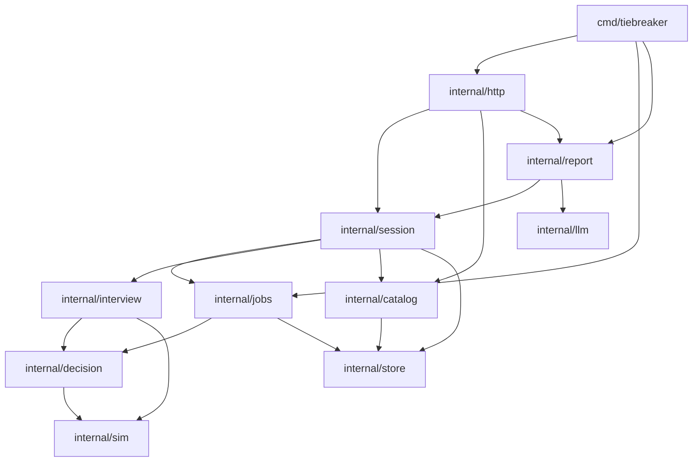

# Architecture

## Processes

One Go binary, `tiebreaker`, runs as:

| Mode | How it starts | Responsibility |
|---|---|---|
| API | `tiebreaker serve` (or `TIEBREAKER_MODE=serve`) | HTTP API (Gin); in-process quick simulations for the interview; SSE |
| Worker | `tiebreaker worker` (or `TIEBREAKER_MODE=worker`) | claims full-simulation jobs, runs the engine, tipping points and reports |
| One-shot | `tiebreaker migrate up`, `admin-token`, `verify-run` | migrations, admin JWTs, reproduction checks |

Both long-running modes use **PostgreSQL 16** as the source of truth (catalogue, sessions, answers, runs, results, reports) and **Redis 7** for pub/sub progress, rate limits and caches (quick sims, LLM). The **Next.js** frontend in `web/` talks to the API only.

## Package dependencies

- `sim` and `decision` are **pure**: no I/O, no globals, plain structs in and out. golangci-lint's `depguard` forbids them from importing `http`, `store`, `llm`, `jobs`, GORM, Redis, Gin or the old `math/rand`.
- Cross-package callbacks (report writing when a run finishes, the none_fit report, session state changes from the worker) go through small interfaces and function hooks wired in `cmd/tiebreaker`, so dependencies only point one way.
- `apperr` holds the shared domain errors. `internal/http/errors.go` is the only place they become HTTP status codes.

## Key mechanisms

| Concern | Mechanism | Where |
|---|---|---|
| Concurrent edits | optimistic locking: `UPDATE … WHERE version = ?`, ETag/If-Match | `session/service.go` |
| Safe retries | idempotency key claimed in the same transaction, before the version check | `session/answers.go` |
| Determinism | chunk PCG streams + named sub-streams + index-addressed samples | `sim/run.go`, `sim/rng.go` |
| Adaptive interview | information gain over brackets with quick sims on a fixed seed | `interview/planner.go` |
| Background jobs | `FOR UPDATE SKIP LOCKED`, leases, heartbeat, fencing on `worker_id` | `jobs/queue.go`, `jobs/worker.go` |
| Live progress | Redis pub/sub + Postgres; SSE subscribes before reading | `jobs/progress.go`, `http/simulations.go` |
| Honest prose | facts first; template always; LLM only if it passes the validator | `report/` |
| Reproducibility | inputs + assumption snapshot + seed stored; `verify-run` | `jobs/verify.go` |

See [FLOW.md](../FLOW.md) for the call paths and [DECISIONS.md](../DECISIONS.md) for the reasons.
